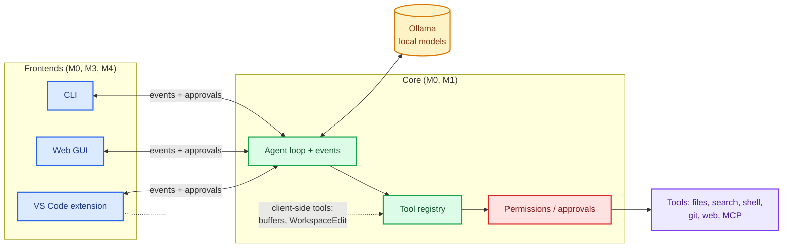
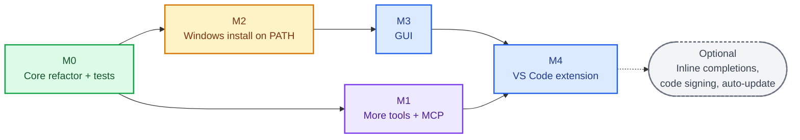

# local-agent: expansion plan

Goals: (1) more tools, (2) a GUI, (3) a standalone app on PATH for every Windows account on this machine, (4) a VS Code extension usable like GitHub Copilot or Claude Code.

Items marked **verify** are things I could not confirm from the code and should be checked before building on them.

## 1. Key idea: split the core from the frontends

All four goals share one blocker. Today [agent.py](src/local_agent/agent.py) mixes the agent loop, the tools, the approval prompts (`input()` inside `write_file` and `run_command`) and the output (`print`). A GUI or an extension cannot answer an `input()` call.

So the first milestone is a refactor, and every later goal plugs into it:



Colour key: blue = frontends, green = core, red = approvals/security, purple = tools, amber = external (Ollama).

The core talks to any frontend through **events** and an **approval callback**, never through `print` or `input`.

| Direction | Message | Purpose |
| --- | --- | --- |
| frontend to core | `user_message`, `approval_response`, `cancel` | drive a turn |
| frontend to core | `tool_result` | result of a tool the *client* executed (see below) |
| core to frontend | `text_delta` | streamed model text |
| core to frontend | `tool_call`, `tool_result` | show what the agent is doing |
| core to frontend | `approval_request` | ask before writes, commands, network |
| core to frontend | `turn_done`, `error` | end of turn, failures |

Design the registry so a tool can run **in the core** (CLI, GUI) or **in the client** (VS Code: read unsaved buffers, apply edits as a `WorkspaceEdit`). This one decision makes the extension much cleaner later.

Target layout:

```
src/local_agent/
  core/         loop, events, session, ollama client wrapper
  tools/        registry + fs, search, shell, git, web, mcp
  permissions.py  approval policy
  config.py       settings (TOML, per user)
  frontends/    cli.py, server.py (stdio + websocket)
  web/          built GUI assets
extensions/vscode/   TypeScript extension
packaging/           PyInstaller spec, installer script
tests/
```

## 2. Milestones

### M0: core refactor and hardening

- Event stream + `Approver` interface replace `input()`/`print`. CLI becomes the first frontend.
- Tool registry: a `@tool` decorator with name, description, JSON schema (from type hints), risk tier and handler location (core or client).
- Streaming (`stream=True`) and cancel support. Needed for any responsive GUI.
- Set `num_ctx` explicitly in the Ollama options and track token use. Ollama's default context window is small (**verify** for your version) and silently truncates long chats, which breaks agents.
- Config file in the per-user config dir (`platformdirs`): model, host, limits, workspace root. CLI flags override it.
- Workspace sandbox: resolve paths and reject anything outside the workspace root unless approved.
- Remaining review items: Ollama-down error message, Ctrl+C leaving an unanswered tool call, `tool_name` in tool messages, and a fallback parser for models that print a tool call as text (what `qwen2.5-coder:7b` did). Probe the model's `tools` capability at startup and warn if it is missing.
- Tests: pytest with a fake Ollama client; CI on GitHub Actions (windows-latest).

**Done when:** the CLI behaves as today but runs on the event/approval interfaces, and the loop is tested without a real model.

### M1: more tools

Risk tiers decide approval behavior:

| Tier | Auto-allowed? | Tools |
| --- | --- | --- |
| read | yes | `read_file` (with line ranges), `list_dir`, `glob`, `grep`, `git_status`, `git_diff`, `git_log` |
| write | ask | `edit_file` (exact-match replace, shows a diff), `write_file`, `git_commit` |
| exec | ask | `run_command` (choose PowerShell or cmd), `run_tests` |
| network | ask, off by default | `web_fetch` |

- Prefer `edit_file` over whole-file rewrites: smaller outputs, fewer mistakes from small models, and a real diff to approve.
- **MCP client support** (official `mcp` Python SDK): lets you reuse existing MCP servers as tools without writing each one. Highest leverage item in this milestone.
- Plugin loading from a user tools directory or Python entry points.
- Small models degrade with many tools. Add tool profiles (for example `minimal`, `coding`, `all`) and keep descriptions short.
- "Allow always for this session" option on approvals, scoped per tool and per workspace.

**Done when:** adding a tool is one decorated function plus a test.

### M2: standalone Windows app (before the GUI; it only needs M0)

Requirement: runs from anywhere, for any account on this device.

- **Stopgap now:** `uv tool install .` puts `local-agent` on PATH for *your* account only.
- **Real packaging:** PyInstaller or Nuitka in `--onedir` mode (faster start than `--onefile`, which unpacks to temp on every launch and trips antivirus more often). **Verify** that your chosen tool supports Python 3.14; if not, lower `requires-python` for the build.
- **Installer:** Inno Setup (or WiX for MSI) with admin rights, installing to `C:\Program Files\local-agent\` and adding that folder to the *machine* PATH. A per-user install under `%LOCALAPPDATA%` would only reach one account, so it does not meet the requirement.
- **Keep state per user.** The install directory is read-only and shared. Config, logs and session history go in `%APPDATA%\local-agent` for each account, never in Program Files.
- **Ollama is not shared by default.** On Windows it normally installs per user, with models under each user's profile (**verify**). Other accounts need their own Ollama and pulled models, or a machine-wide `OLLAMA_MODELS` setting. Two logged-in accounts also compete for port 11434. Document this in the README and make the host configurable.
- Entry points: `local-agent` (CLI), `local-agent gui`, `local-agent serve --stdio`, with `--model` and `--cwd` flags.
- CI builds the installer and attaches it to GitHub Releases.
- Unsigned executables trigger SmartScreen and Defender warnings. That is fine on your own machine. For distribution you need a code-signing certificate.

**Done when:** a second Windows account, after running the installer once, can open a terminal anywhere and run `local-agent`.

### M3: GUI

- **Approach:** the core runs a local server (FastAPI + WebSocket) that streams the same events. A web frontend renders them. Later, wrap it in a native window with `pywebview` so it feels like an app.
- **Screens:** chat with streaming text, tool-call cards, approval dialogs with a diff view, model picker, settings, session history.
- **Security matters here.** A localhost server that can run commands is a target. Bind to `127.0.0.1` only, require a random per-launch token, and check the `Origin` header so a random web page cannot drive your agent.
- Alternatives I do not recommend: a native toolkit such as PySide6 means a second UI codebase that cannot be reused in VS Code, and a Textual TUI is not a GUI.
- The web bundle is reused inside the VS Code extension, so build it as a standalone static app from the start.

**Done when:** `local-agent gui` opens a window where you can chat, see tool calls, and approve or deny writes.

### M4: VS Code extension

- TypeScript extension in `extensions/vscode/`. It starts `local-agent serve --stdio` as a child process and exchanges the same events as JSON lines. Stdio avoids ports and the localhost-auth problem entirely.
- **UI choice** (decide at the start of this milestone):
  - *Own webview panel* (how Claude Code's extension works): reuses the M3 web bundle, full control of the UI. Recommended first.
  - *Chat Participant API* (`@local-agent` in VS Code's built-in Chat view): feels like Copilot, uses VS Code's own tool-confirmation UI, but you depend on that API's shape. **Verify** against the current VS Code docs.
- **Editor integration through client-side tools:**
  - Read tools see unsaved buffers.
  - Edits are applied as a `WorkspaceEdit` with a diff preview, so VS Code's undo works.
  - Commands run in an integrated terminal or task.
  - Context comes from selection, open files and diagnostics, with "Add selection to chat" and `@file` mentions.
- **Inline completions** (ghost text, the most Copilot-like feature) are a separate path: an `InlineCompletionItemProvider` calling Ollama's fill-in-the-middle endpoint directly, with a model that supports it. `qwen2.5-coder:7b` reports the `insert` capability. This does not use the agent loop and needs its own latency work. Treat it as an optional stretch.
- **Packaging:** `vsce package` produces a `.vsix`. Either require `local-agent` on PATH (simple, matches M2) or bundle the executable in a Windows-specific `.vsix`. Install with `code --install-extension`. Extensions install per user, so each Windows account installs it once. The Marketplace needs a publisher account; Open VSX is the alternative.

**Done when:** in VS Code you can ask a question about the open file, approve an edit as a diff, and undo it.

## 3. Suggested order



Colour key: green = foundation, purple = tools, amber = packaging/delivery, blue = user interfaces, grey dashed = optional. M1 and M2 only depend on M0, so they can run in parallel.

M2 comes before M3 because it is low risk and gives you the "run anywhere" result early. The GUI and extension then ship inside the same installer.

## 4. Cross-cutting concerns

- **Security:** approvals, workspace sandbox and localhost token (M3). Also prompt injection: file contents or web pages can contain instructions, so risky tools must always ask no matter what the model says.
- **Model quality:** small local models make more tool-call mistakes. Mitigate with tool profiles, short schemas, a capability probe, and the text-tool-call fallback. Keep a short list of tested models in the README.
- **Protocol:** before inventing one, check whether the Agent Client Protocol (used by editors for agent frontends) fits the event set above (**verify**).
- **Testing:** fake-Ollama unit tests in CI, protocol tests for the server, a manual end-to-end script against a real small model.
- **Logging:** per-user log and transcript files with a setting to turn them off.

## 5. Open decisions (defaults chosen)

| Decision | Default in this plan |
| --- | --- |
| GUI technology | local web UI, optionally in `pywebview` |
| Extension UI | own webview first, Chat Participant API later |
| Packaging tool | PyInstaller `--onedir` + Inno Setup |
| Install scope | per machine (admin), state per user |
| Inline completions | optional stretch after M4 |
| Repo structure | single monorepo (`extensions/vscode/` inside this repo) |
